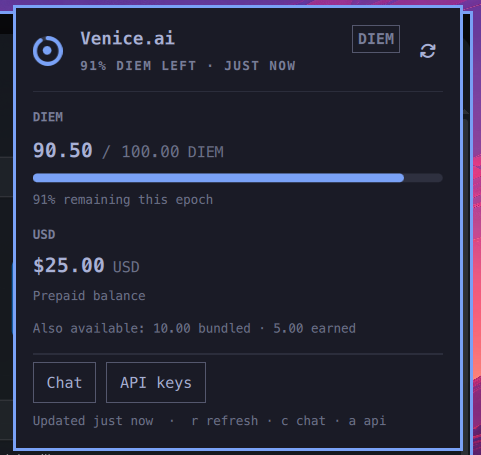

# Venice Balance for Omarchy

A native [Omarchy](https://omarchy.org/) bar widget for your
[Venice.ai](https://venice.ai/) credit balance. A thin ring in the bar shows
how much of the current DIEM epoch is left; click it for the DIEM and USD
balances, the token setup, the app launcher and quick links.



The ring, text and panel are built from Omarchy's theme tokens (`accent`,
`urgent`, `foreground`, corner radius, fonts and spacing), so every theme —
light, dark, mono or colourful — gets a widget that looks like it belongs.

## Features

- **Ring gauge** for the current DIEM epoch (`diem / diemEpochAllocation`).
  The centre dot is filled when Venice will spend, hollow when it will not.
  When there is no DIEM allocation, a full ring means USD credit is available.
- **Both balances** in the panel: DIEM remaining versus the epoch allocation,
  with a progress bar and a countdown to the next reset (00:00 UTC), and the
  prepaid USD balance (negative USD is shown as owed).
- **Theme-aware status**: `accent` when healthy, `urgent` below the low-balance
  threshold or when depleted. No hardcoded green/amber/red.
- **Optional bar label**: `none` (default, icon only), `auto`, `percent`, `usd`,
  `diem` or `both`. Always hidden on a vertical bar; the tooltip still has the
  full picture.
- **Token setup in the panel**, stored in the system keyring by default. The
  token is never shown again, never written to `shell.json`, and never passed
  in argv.
- **Honest states**: loading, no token, rejected token, keyring unavailable,
  offline with the last known balance, and per-request HTTP errors.
- **Venice.ai as an app**: after the first successful balance the plugin
  installs (or updates) a `Venice.ai` launcher that opens
  `https://venice.ai/chat` in its own browser app window. Runs once; disable
  it with `autoInstallApp false`. Chat and `c` open the app window, focusing
  the existing one when it is already running.
- **Keyboard**: `r` refresh, `c` open Chat in the app window, `a` open API
  keys in its own app window, `Esc` close. Chat and API keys dismiss the panel
  before handing off; Install / Update / Retry keep it open.
- **One poller for all monitors**: the widget declares a `service`, so a
  multi-monitor bar does not make two API requests a minute.

## Install

```bash
omarchy plugin add https://github.com/haplo/omarchy-venice.git --enable
```

The widget lands in the right section of the bar. Saving files under
`~/.config/omarchy/plugins/net.fidelramos.venice/` reloads the plugin, but the
shell deliberately keeps live bar-widget and service instances across a
rescan. If a UI or service change does not appear, `omarchy restart shell`
loads the new code.

## First run

Click the ring and paste an admin API token from
[venice.ai/settings/api](https://venice.ai/settings/api). Press Enter or choose
**Save token**.

The default storage is the **system keyring** (the Secret Service that Omarchy
already runs through `gnome-keyring` and `libsecret`'s `secret-tool`). There is
no extra package to install.

If the keyring is locked or unavailable, the panel says so and offers
**Store token in a private file** — a `0600` file at
`~/.local/state/venice/token`, in a `0700` directory. You can also choose that
up front:

```bash
omarchy bar set net.fidelramos.venice tokenStorage file
```

The two backends are never silently mixed: storing a token in one clears the
other, so a stale copy cannot keep answering after a switch.

On the first successful balance the plugin also installs **Venice.ai as an app** via
`omarchy-webapp-install`: a normal launcher in your app menu whose `Exec` is
`omarchy-launch-webapp "https://venice.ai/chat"`. The icon is reused if it already
exists, otherwise it is fetched from the site. Turn the autoinstall of the app off with:

```bash
omarchy bar set net.fidelramos.venice autoInstallApp false
```

The APP section in the panel shows the current state and offers
Install / Update / Open. To remove the app manually, use
`omarchy webapp remove "Venice.ai"`.

## Settings

```bash
omarchy bar set net.fidelramos.venice barLabel usd
omarchy bar set net.fidelramos.venice refreshIntervalSec 120
omarchy bar set net.fidelramos.venice warnAtPercent 15
omarchy bar set net.fidelramos.venice autoInstallApp false
```

| Key | Default | What it does |
| --- | --- | --- |
| `refreshIntervalSec` | `30` | Balance poll interval (15–3600). Polling pauses after a rejected token and backs off for 5 minutes when the token backend is unavailable. |
| `barLabel` | `none` | `none` is the ring only. `auto` is the DIEM percentage when staking, otherwise USD. Also `percent`, `usd`, `diem`, `both`. |
| `warnAtPercent` | `25` | At or below this percentage of the DIEM allocation the ring and progress bar switch to `urgent`. |
| `tokenStorage` | `keyring` | `keyring` or `file`. See above. |
| `autoInstallApp` | `true` | After the first successful balance, install or update the Venice.ai web app launcher once. Turn off to leave your app launcher untouched. |

The bar button: **left** opens the panel, **right** refreshes, **middle**
copies the balance summary to the clipboard.

## How it works

```
Panel.qml            bar button + popup, reads the shared service
Service.qml          one poller: timer, token lifecycle, last good snapshot
VeniceRing.qml       Canvas ring gauge, theme colours only
Model.js             pure parsing, formatting, tiers, labels, tooltips
bin/venice-billing   token lookup + curl; prints one JSON object
bin/venice-app       status/ensure/install for the Venice.ai web app launcher
```

`bin/venice-billing balance` reads the token, calls
`GET https://api.venice.ai/api/v1/billing/balance`, and prints either
`{"ok":true,"storage":"keyring","data":{...}}` or
`{"ok":false,"kind":"auth|network|http|keyring|file|parse|no-token","message":"..."}`.
Balance requests read the token inside the helper. The QML only handles it
once, in the password field where you paste it, and then only long enough to
hand it to the helper over stdin. `curl` receives the `Authorization` header
on stdin (`--config -`), not in argv, and every request has a connect and
total timeout.

Venice answers an invalid Bearer key with **402** (the x402 challenge) as well
as 401/403; all three mean "replace the token" to this widget.

No telemetry, no analytics, no third-party services. The only network request
is the balance lookup to `api.venice.ai`.

## Troubleshooting

```bash
omarchy-shell net.fidelramos.venice status     # one-line summary
omarchy-shell net.fidelramos.venice refresh
omarchy-shell net.fidelramos.venice toggle
omarchy-shell net.fidelramos.venice chat       # close the panel, open Chat
omarchy-shell net.fidelramos.venice api        # close the panel, open API keys in its app window
```

- **Keyring unavailable**: unlock it (your login keyring is normally unlocked
  by PAM at login) or switch to `tokenStorage file` and paste the token again.
- **Token rejected**: the token was revoked, expired or restricted. Create a
  new one at [venice.ai/settings/api](https://venice.ai/settings/api).
- **Offline / last known**: the widget keeps the last successful balance and
  marks it with an urgent dot and `last known` in the tooltip. It retries on
  the normal interval.
- **Nothing after an edit to `Service.qml`**: `omarchy restart shell`.
- **App did not install**: the panel APP section shows the error and a Retry.
  The installer fetches the favicon, so a network or icon failure leaves the
  launcher untouched and the one-shot marker unwritten. The install also
  refuses to overwrite a `Venice.ai` launcher that was not created by
  `omarchy-webapp-install`; remove it first if you want the managed one.
- **App menu still opens the old page**: the automatic update is one-shot. Use
  **Update to Chat** in the panel, or
  `omarchy webapp install "Venice.ai" "https://venice.ai/chat" ""`.

## Development

```bash
omarchy plugin validate .
node --test tests/model.test.js
./tests/helper.test.sh
./tests/app.test.sh
```

`tests/helper.test.sh` stubs `curl` and `secret-tool`, so it needs no token and
no network. It checks the JSON contract, the auth/HTTP/network mappings, that
the token never appears in curl's argv, the keyring failure path, and the
file permissions.

`tests/app.test.sh` stubs `omarchy-webapp-install` and `update-desktop-database`
in a temporary `$HOME`. It checks install, the `/` → `/chat` update, the
one-shot marker, the foreign-launcher guard, icon reuse vs fetch, and failure
handling.

To test a working tree in place:

```bash
rsync -a --delete --exclude .git ~/Code/omarchy-venice/ \
  ~/.config/omarchy/plugins/net.fidelramos.venice/
omarchy restart shell
```

Release notes live in [CHANGELOG.md](CHANGELOG.md); the release process is
documented in [RELEASING.md](RELEASING.md).

## Disclaimer

This plugin is not affiliated with, endorsed by, or developed by Venice.ai.
All trademarks and brand names belong to their respective owners.

## License

[MIT](LICENSE).
